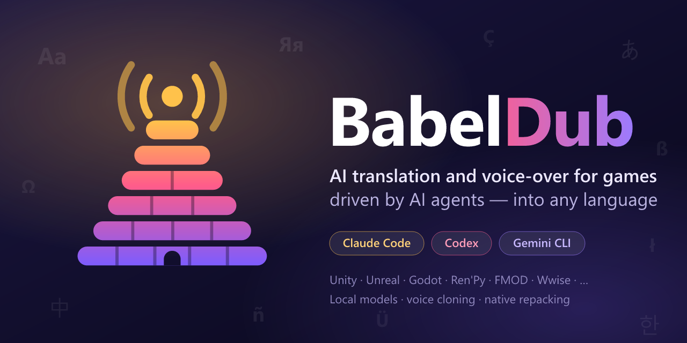
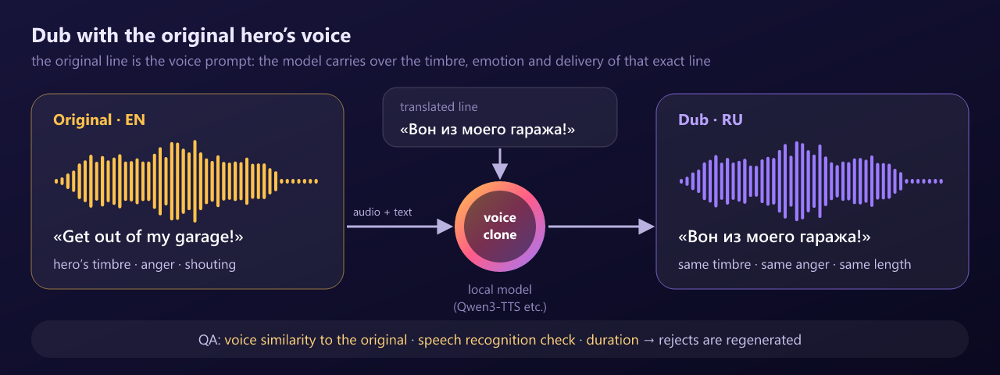
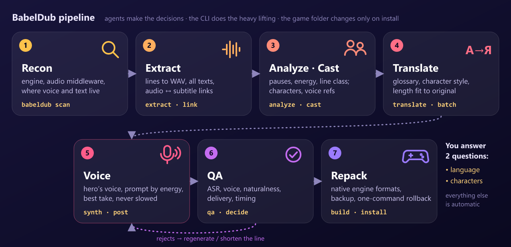

<p align="center">
  
</p>

<p align="center">
  <a href="LICENSE"></a>
  <a href="https://github.com/KROU4/BabelDub/releases"></a>
  <a href="https://github.com/KROU4/BabelDub/actions/workflows/ci.yml"></a>
  
  
</p>

<p align="center"><b>English</b> · <a href="README.ru.md">Русский</a></p>

**BabelDub** is not an app. It is a pack of **skills, agents, commands and hooks** for AI coding agents (Claude Code, Codex, Gemini CLI and others). Point your agent at a game folder and name a language. The agent figures out the engine, finds the voice-over and the subtitles, translates the text, **re-voices every character in their own original voice** with local neural models, and repacks the files so the game loads them natively.

> Low-Budget Repairs (Unity + FMOD) is the first game the pipeline was developed on. BabelDub itself is engine-agnostic: recon detects the engine and the audio middleware and picks the matching adapter or playbook.

## The original hero's voice, not a "TTS voice"

<p align="center"></p>

BabelDub's core principle is **dubbing with the original character's voice**: the same timbre, the same emotion, the same delivery — just in your language. First the agent listens to every original line: where the speech starts and pauses, what is said, how loud and how animated it is. The voice prompt is always the character's own original recordings, matched to the line's energy (calm, animated, shouting, quiet): a long reference of the actor's clean lines gives the timbre, and once the character's first dubbed lines pass QA, the best of them become prompts in your language so the rest sounds native, not accented. Every line is generated several times, and the take that best keeps the original's delivery, naturalness, length and voice wins; an RVC model trained on each main character's lines then pulls the timbre back to the original actor. Speech is never slowed down to fill time: pauses are shortened or the speech is sped up a little (at most ×1.15), and cutscene lines are placed phrase by phrase on the original's timing. Screams, laughs and interjections keep the original audio. QA compares every dub with the original speaker and sends lines whose voice, words, naturalness or timing drifted back for regeneration. Lip-sync is not touched: only the audio changes, and each file keeps exactly the original's length.

## How it works

<p align="center"></p>

1. **Recon** — engine, audio middleware (FMOD, Wwise, CRIWARE…), where voice and text live, support level.
2. **Extract** — lines to WAV, texts in every language, audio ↔ subtitle links by engine keys.
3. **Analyze** — every original line: speech segments and pauses, what is actually said (speech recognition with word times), pitch range, loudness and speaking rate, and a line class (speech, short word, interjection, nonverbal).
4. **Cast** — characters from game metadata or voice clustering, main roles, voice references sorted by energy (calm, animated, loud, soft).
5. **Translate** — translator agents work in scene batches with a glossary, character style, placeholder checks and a length budget from the original's speech span and the character's speaking rate. If the game already ships an official translation, it is adapted for speech (numbers as words, names transliterated, colloquial) and stays the subtitle.
6. **Voice** — local voice cloning (VoxCPM2 by default) with a prompt matched to the line's energy, several takes scored for delivery, naturalness, length and voice, exact length and loudness of the original without slowing speech down, then RVC timbre transfer per main character.
7. **QA** — speech recognition of the dub (CER), speaker similarity, naturalness (UTMOS), delivery compared with the original, cutscene timing; rejects are regenerated or shortened, and what cannot be fixed keeps the original.
8. **Repack** — native engine containers (for example, FMOD `.bank` files are rebuilt without proprietary tools), installed with a backup and one-command rollback.

You are asked **exactly two questions**: which language, and which characters to dub (all, the main ones, or a list). Everything else is automatic and summarized in a final report. The agent talks to you in your language.

## Quick start

### Claude Code

```text
/plugin marketplace add KROU4/BabelDub
/plugin install babeldub@babeldub
```

Then:

```text
/babeldub:localize "D:\Games\MyGame" ru
```

or just say: "Translate and re-voice the game in D:\Games\MyGame into Spanish."

### Codex, Gemini CLI, Cursor and other agents

Exact install commands for every host are in [docs/HOSTS.md](docs/HOSTS.md). In short:

```bash
codex plugin marketplace add KROU4/BabelDub
```

```bash
gemini extensions install https://github.com/KROU4/BabelDub
```

```bash
npx skills add KROU4/BabelDub
```

### No install: the "next to the game" kit

Download `babeldub-kit-<version>.zip` from [Releases](https://github.com/KROU4/BabelDub/releases), unpack it anywhere and open the folder in your AI agent. The agent instructions are in `AGENTS.md` and `.agents/skills`.

### What your computer needs

| | Minimum | Recommended |
|---|---|---|
| OS | Windows 10/11 or Linux | Windows 11 / Ubuntu 22.04+ |
| GPU | none — works, but slowly and at lower quality | NVIDIA with 8 GB VRAM (developed on an RTX 3060 Ti) |
| Software | Python 3.10+, [uv](https://docs.astral.sh/uv/), ffmpeg | + git |
| Disk | ~20 GB for models and environments | + room for the project (depends on the amount of voice-over) |

**GPU-first:** when an NVIDIA GPU is present, every neural workload (voice cloning, speech recognition, speaker embeddings) runs on it automatically. The agent installs models and environments itself with `babeldub setup` into `~/.babeldub` (`C:\Users\<you>\.babeldub` on Windows; override with the `BABELDUB_HOME` environment variable). The repository contains no model weights and no game assets.

## Engine support

| Engine / format | Extraction | Native rebuild | Level |
|---|---|---|---|
| **FMOD Studio** (`.bank`, localized audio tables) | ✅ own parser + vgmstream | ✅ own FSB5 writer (FADPCM / PCM16) | A |
| **Loose audio files** (`.ogg`, `.wav`, `.mp3`, `.opus`… — Ren'Py, RPG Maker, many indies) | ✅ | ✅ re-encoded to the original format | A |
| **Unity Localization** (string tables in Addressables) | ✅ texts in all languages | ⏳ writing in v0.2 | A (read) |
| **Wwise** (`.bnk`, `.wem`, `.pck`) | ✅ via vgmstream | 🛠 needs WwiseConsole of the same version | B |
| Unreal Engine 4/5, Godot, GameMaker, Source, CRIWARE, Bethesda | 📖 playbooks in the skills | 📖 step-by-step recipes | B/C |
| Online games with anti-cheat | — | ❌ refused by default | — |

**A** — fully automatic; **B** — needs a tool the user installs; **C** — the agent follows a written playbook. Details: [docs/ENGINES.md](docs/ENGINES.md).

## Models

| Task | Default (8 GB VRAM) | License |
|---|---|---|
| Voice cloning | VoxCPM2 (2B, 48 kHz, 30 languages incl. English, Russian, Polish, German, French, Spanish, Japanese, Chinese) | Apache-2.0 |
| Timbre transfer | RVC v2 via Applio, one model per main character trained on its original lines | MIT |
| Smaller GPUs and CPU | Qwen3-TTS-12Hz (1.7B / 0.6B), Chatterbox Multilingual for Polish, Turkish and more | Apache-2.0, MIT |
| Speech segments, speech recognition | Silero VAD + faster-whisper large-v3-turbo | MIT |
| Speaker similarity | SpeechBrain ECAPA | Apache-2.0 |
| Naturalness | UTMOS22 (SpeechMOS) | MIT |

Chosen in blind listening rounds on Low-Budget Repairs (English → Russian): VoxCPM2 + RVC reached a CER of 0.045 (Qwen3-TTS + RVC: 0.050) and a speaker similarity of ~0.65–0.70 to the original actor, whose own lines score 0.77 among themselves.

**v0.2 against v0.1** on a 38-line test set (six characters, short words, cutscenes; the same Russian texts, the same metrics): slowed-down lines 17 → 0, time-stretched lines 74 % → 15 %, UTMOS naturalness 2.64 → 3.14 (the originals score 3.14), speaker similarity 0.544 → 0.606, the gap between the dub's and the original's pitch range 5.6 → 3.4 semitones, CER of the dubbed lines 0.054 → 0.034. Five of the 38 lines (shouts that could not be voiced recognizably) keep the original. Only permissively licensed models (Apache/MIT) are installed by default. Non-commercial models are enabled only with your explicit consent. Tiers for CPU, 12 and 24 GB GPUs: [docs/MODELS.md](docs/MODELS.md).

## Responsible use

BabelDub is meant for personal and fan localizations. Voices belong to their actors and games to their rights holders. Do not distribute extracted assets or rebuilt game files: share instructions and project patches that everyone builds locally from their own copy of the game. More in [docs/LEGAL.md](docs/LEGAL.md).

## Repository layout

```text
skills/            Agent Skills: localize, doctor, recon, cast, translate, voice, qa, pack
claude/            Claude Code subagents and hooks
commands/          /babeldub:localize and /babeldub:rollback
runtime/           the babeldub CLI: format adapters, model workers, pipeline stages
docs/              hosts, engines, models, legal, developer contract
assets/            logo and illustrations
```

## Contributing

New engines and formats are the most valuable contribution. How to add an adapter and a playbook: [CONTRIBUTING.md](CONTRIBUTING.md). Game assets are never accepted into the repository.

## License

[MIT](LICENSE). Third-party tools and models keep their own licenses — see [THIRD_PARTY_NOTICES.md](THIRD_PARTY_NOTICES.md).
