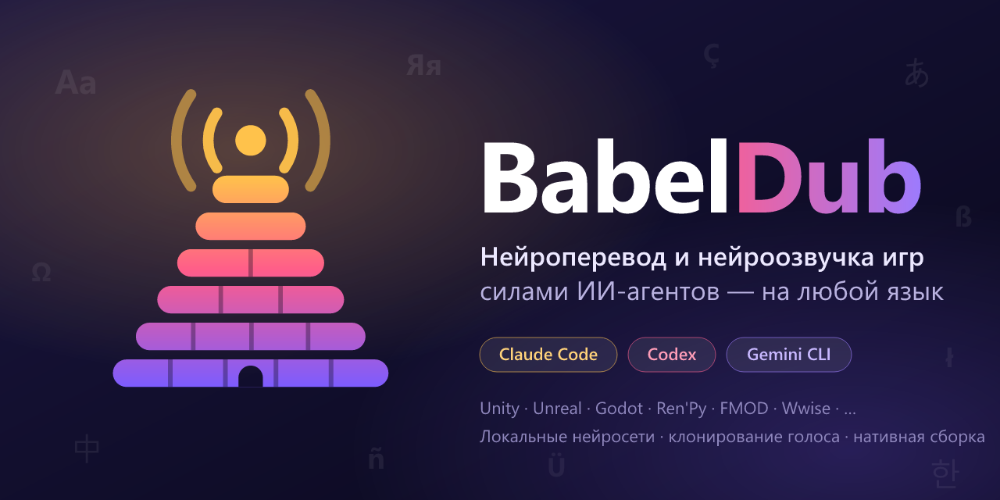
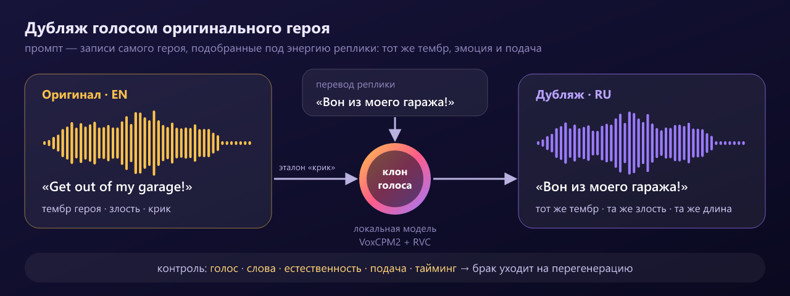
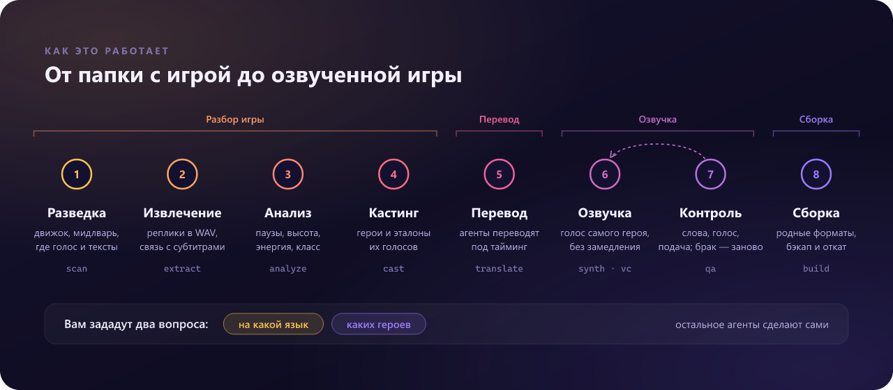

<p align="center">
  
</p>

<p align="center">
  <a href="LICENSE"></a>
  <a href="https://github.com/KROU4/BabelDub/releases"></a>
  <a href="https://github.com/KROU4/BabelDub/actions/workflows/ci.yml"></a>
  
  
</p>

<p align="center"><a href="README.md">English</a> · <b>Русский</b></p>

**BabelDub** — это не программа, а набор **скиллов, агентов, команд и хуков** для ИИ-агентов (Claude Code, Codex, Gemini CLI и других). Вы даёте агенту путь к папке игры и называете язык. Дальше агент сам разбирается, на каком движке сделана игра, где лежат озвучка и субтитры, переводит тексты, **переозвучивает героев их же голосами** на локальных нейросетях и собирает файлы обратно так, чтобы игра приняла их как родные.

> Low-Budget Repairs (Unity + FMOD) — первая игра, на которой отлажен конвейер. Сам BabelDub универсален: разведка определяет движок и аудио-мидлварь и подключает подходящий адаптер или инструкцию.

## Голос оригинального героя, а не «синтезатор»

<p align="center"></p>

Главный принцип BabelDub — **дубляж голосом оригинального персонажа**: тот же тембр, та же эмоция, та же подача, но на вашем языке. Сначала агент «слушает» каждую оригинальную реплику: где начинается речь и где паузы, что сказано, насколько громко и эмоционально. Голосовой промпт всегда собирается из оригинальных записей героя и подбирается под энергию реплики (спокойно, оживлённо, крик, тихо): длинный эталон из чистых реплик актёра задаёт тембр, а когда первые озвученные реплики героя проходят контроль, лучшие из них становятся промптами на вашем языке — и остальное звучит по-родному, без акцента. Каждую реплику модель генерирует несколько раз, и побеждает дубль, который лучше сохранил подачу оригинала, естественность, длину и голос; затем RVC-модель, обученная на репликах каждого главного героя, возвращает тембр к оригинальному актёру. Речь никогда не замедляется ради длины: сокращаются паузы или речь чуть ускоряется (не больше ×1,15), а реплики катсцен раскладываются по фразам на тайминг оригинала. Крики, смех и междометия остаются оригинальными. Контроль качества сравнивает дубль с оригиналом по голосу, словам, естественности и таймингу и отправляет «уплывшие» реплики на перегенерацию. Мимику и липсинк BabelDub не трогает: меняется только звук, а каждый файл сохраняет точную длину оригинала.

## Как это работает

<p align="center"></p>

1. **Разведка** — движок, аудио-мидлварь (FMOD, Wwise, CRIWARE…), где голос и где тексты, уровень поддержки.
2. **Извлечение** — реплики в WAV, тексты всех языков, связь «аудио ↔ субтитр» по ключам.
3. **Анализ** — каждая оригинальная реплика: сегменты речи и паузы, что сказано на самом деле (распознавание со временем слов), диапазон высоты, громкость и темп, класс реплики (речь, короткое слово, междометие, невербальное, смешанное).
4. **Кастинг** — персонажи по метаданным игры или кластеризации голосов, главные роли, эталоны голоса по энергии (спокойно, оживлённо, крик, тихо).
5. **Перевод** — ИИ-агенты-переводчики работают пакетами по сценам: глоссарий, стиль героя, плейсхолдеры, бюджет длины по длительности речи оригинала и темпу героя. Если в игре уже есть официальный перевод, он адаптируется под устную речь (числа словами, имена кириллицей, разговорный стиль) и остаётся в субтитрах.
6. **Озвучка** — клонирование голоса героя локальной моделью (по умолчанию VoxCPM2) с промптом под энергию реплики, несколько дублей с оценкой подачи, естественности, длины и голоса, точная длина и громкость оригинала без замедления речи, затем перенос тембра RVC для главных героев.
7. **Контроль** — распознавание синтеза (CER), сходство голоса, естественность (UTMOS), подача в сравнении с оригиналом, тайминг катсцен; брак уходит на перегенерацию или сокращение текста, а неисправимое остаётся оригиналом.
8. **Сборка** — нативные контейнеры движка (например, FMOD `.bank` пересобирается без проприетарных утилит), установка с бэкапом и откат одной командой.

Вам задают **ровно два вопроса**: на какой язык переводить и каких персонажей озвучивать (всех, главных или по списку). Всё остальное — автоматически, с отчётом в конце.

## Быстрый старт

### Claude Code

```text
/plugin marketplace add KROU4/BabelDub
/plugin install babeldub@babeldub
```

Затем:

```text
/babeldub:localize "D:\Games\MyGame" ru
```

или просто напишите: «Переведи и переозвучь игру в папке D:\Games\MyGame на русский».

### Codex, Gemini CLI, Cursor и другие агенты

Подробные команды установки для каждого хоста — в [docs/HOSTS.md](docs/HOSTS.md). Кратко:

```bash
codex plugin marketplace add KROU4/BabelDub
```

```bash
gemini extensions install https://github.com/KROU4/BabelDub
```

```bash
npx skills add KROU4/BabelDub
```

### Без установки: архив «рядом с игрой»

Скачайте `babeldub-kit-<версия>.zip` со страницы [Releases](https://github.com/KROU4/BabelDub/releases), распакуйте в любую папку и откройте её в своём ИИ-агенте. Инструкции агенту лежат в `AGENTS.md` и `.agents/skills`.

### Что нужно на компьютере

| | Минимум | Рекомендуется |
|---|---|---|
| ОС | Windows 10/11 или Linux | Windows 11 / Ubuntu 22.04+ |
| GPU | без GPU — медленно, качество ниже | NVIDIA с 8 ГБ VRAM (проверено на RTX 3060 Ti) |
| Софт | Python 3.10+, [uv](https://docs.astral.sh/uv/), ffmpeg | + git |
| Диск | ~20 ГБ (модели и окружения) | + место под проект (зависит от объёма озвучки) |

Модели и окружения ставит сам агент командой `babeldub setup` в папку `~/.babeldub` (в Windows — `C:\Users\<вы>\.babeldub`, переопределяется переменной `BABELDUB_HOME`). В репозитории нет ни весов моделей, ни ассетов игр.

## Поддержка движков

| Движок / формат | Извлечение | Нативная сборка | Уровень |
|---|---|---|---|
| **FMOD Studio** (`.bank`, локализованные аудиотаблицы) | ✅ свой парсер + vgmstream | ✅ свой писатель FSB5 (FADPCM / PCM16) | A |
| **Отдельные аудиофайлы** (`.ogg`, `.wav`, `.mp3`, `.opus`… — Ren'Py, RPG Maker, многие инди) | ✅ | ✅ перекодирование в исходный формат | A |
| **Unity Localization** (string tables в Addressables) | ✅ тексты всех языков | ⏳ запись в v0.2 | A (чтение) |
| **Wwise** (`.bnk`, `.wem`, `.pck`) | ✅ через vgmstream | 🛠 нужен WwiseConsole той же версии | B |
| Unreal Engine 4/5, Godot, GameMaker, Source, CRIWARE, Bethesda | 📖 инструкции в скиллах | 📖 пошаговые рецепты | B/C |
| Онлайн-игры с античитом | — | ❌ по умолчанию отказ | — |

**A** — полностью автоматически; **B** — нужен инструмент, который ставит пользователь; **C** — агент действует по инструкции. Подробнее — в [docs/ENGINES.md](docs/ENGINES.md).

## Модели

| Задача | По умолчанию (8 ГБ VRAM) | Лицензия |
|---|---|---|
| Клонирование голоса | VoxCPM2 (2B, 48 кГц, 30 языков, включая русский и польский) | Apache-2.0 |
| Перенос тембра | RVC v2 через Applio: своя модель для каждого главного героя, обученная на его репликах | MIT |
| Слабые GPU и CPU | Qwen3-TTS-12Hz (1.7B / 0.6B), Chatterbox Multilingual для польского, турецкого и др. | Apache-2.0, MIT |
| Сегменты речи, распознавание | Silero VAD + faster-whisper large-v3-turbo | MIT |
| Сходство голоса | SpeechBrain ECAPA | Apache-2.0 |
| Естественность | UTMOS22 (SpeechMOS) | MIT |

Связку выбрали слепым прослушиванием на Low-Budget Repairs (английский → русский): у VoxCPM2 + RVC CER 0,045 (у Qwen3-TTS + RVC — 0,050), сходство с голосом актёра ~0,65–0,70 при 0,77 между его собственными репликами.

**v0.2 против v0.1** на тестовом наборе из 38 реплик (13 персонажей: длинные реплики, короткие слова, катсцены; те же русские тексты и те же метрики): замедленных реплик 17 → 0, растянутых по времени 74 % → 15 %, естественность UTMOS 2,64 → 3,14 (у оригиналов 3,14), сходство голоса 0,544 → 0,606, разница диапазона высоты дубля и оригинала 5,6 → 3,4 полутона, CER озвученных реплик 0,054 → 0,034. Пять реплик из 38 (выкрики, которые не удалось озвучить узнаваемо) остаются оригиналом. По умолчанию ставятся только модели с открытыми лицензиями (Apache/MIT). Модели с некоммерческой лицензией подключаются только с вашего явного согласия. Тиры для CPU, 12 и 24 ГБ — в [docs/MODELS.md](docs/MODELS.md).

## Ответственное использование

BabelDub предназначен для личных и фанатских локализаций. Голоса принадлежат актёрам, игры — их правообладателям. Не распространяйте извлечённые ассеты и пересобранные файлы игр: делитесь инструкциями и проектами-патчами, которые каждый собирает у себя из своей копии игры. Подробнее — в [docs/LEGAL.md](docs/LEGAL.md).

## Структура репозитория

```text
skills/            скиллы Agent Skills: localize, doctor, recon, cast, translate, voice, qa, pack
claude/            агенты и хуки Claude Code
commands/          команды /babeldub:localize и /babeldub:rollback
runtime/           CLI babeldub: адаптеры форматов, воркеры моделей, стадии конвейера
docs/              документация: хосты, движки, модели, правовые вопросы, контракт разработчика
assets/            логотип и иллюстрации
```

## Участие

Новые движки и форматы — самый ценный вклад. Как добавить адаптер и инструкцию, написано в [CONTRIBUTING.md](CONTRIBUTING.md). Ассеты игр в репозиторий не принимаются.

## Лицензия

[MIT](LICENSE). Сторонние инструменты и модели распространяются под своими лицензиями — см. [THIRD_PARTY_NOTICES.md](THIRD_PARTY_NOTICES.md).
